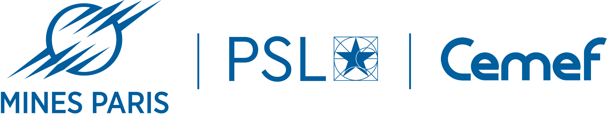

# DLC Wear Prediction

<p align="center">
  
  &nbsp;&nbsp;&nbsp;&nbsp;
  
  &nbsp;&nbsp;&nbsp;&nbsp;
  
</p>

<p align="center">
  <b>Minimal public implementation of machine-learning and physics-integrated approaches for wear prediction of Diamond-Like Carbon (DLC) coatings.</b>
</p>

---

## Overview

This repository provides the main computational workflows associated with the DLC wear-prediction study:

- data-driven machine-learning models,
- physics-constrained target formulations,
- physics-guided neural networks (PGNN).

The implementation is intentionally compact and focuses on the methodology required to execute and inspect the approaches presented in the associated research work.

---

## Repository structure

```text
.
├── main.py
├── common.py
├── data_driven.py
├── physics_constrained.py
├── pgnn.py
├── requirements.txt
├── data/
│   └── DLC_database.xlsx
├── Docs/
│   ├── MinesParis_Cemef_bleu_2.png
│   ├── imra.png
│   └── maison_de_la_chimie.png
└── results/
```

| File | Description |
|---|---|
| `main.py` | Main launcher |
| `data_driven.py` | XGBoost, SVM, Random Forest, KNN, Extra Trees and ANN |
| `physics_constrained.py` | Physics-constrained formulations based on `dV`, `k` and `alpha` |
| `pgnn.py` | ANN and physics-guided neural-network implementations |
| `common.py` | Shared preprocessing, derived physical quantities, splitting and evaluation utilities |

---

## Installation

Python 3.10+ is recommended.

Create a virtual environment:

```bash
python -m venv .venv
```

Activate it on Windows:

```bash
.venv\Scripts\activate
```

or on Linux/macOS:

```bash
source .venv/bin/activate
```

Install the dependencies:

```bash
pip install -r requirements.txt
```

---

## Dataset

A reduced public subset of the research database is provided in:

```text
data/DLC_database.xlsx
```

The public dataset contains the variables required to execute the models included in this repository.

It is a restricted subset of the database used in the associated research study. The complete research database is not distributed with this repository.

Therefore, numerical performance obtained using the public subset is not expected to reproduce exactly the quantitative results reported in the associated publication.

The public data are provided primarily to enable execution and inspection of the computational workflow.

---

## Usage

### Run all approaches

```bash
python main.py --data data/DLC_database.xlsx --study all
```

### Data-driven models

```bash
python main.py --data data/DLC_database.xlsx --study data
```

### Physics-constrained models

Run all formulations:

```bash
python main.py --data data/DLC_database.xlsx --study physics --formulation all
```

Run a specific formulation:

```bash
python main.py --data data/DLC_database.xlsx --study physics --formulation k
```

Available formulations:

```text
dV
k
alpha
```

### Physics-guided neural network

```bash
python main.py --data data/DLC_database.xlsx --study pgnn
```

### Alternative Excel sheet

If a different sheet name is used:

```bash
python main.py --data data/DLC_database.xlsx --sheet "sheet_name" --study all
```

---

## Modeling approaches

### Data-driven learning

The following regression algorithms are included:

- K-Nearest Neighbors
- Support Vector Regression
- Random Forest
- Extra Trees
- XGBoost
- Artificial Neural Network

### Physics-constrained learning

The framework also considers alternative prediction targets constructed from physical quantities:

- `dV`
- `k`
- `alpha`

The corresponding wear rate is reconstructed after prediction.

### Physics-guided neural network

The PGNN combines the data-driven prediction objective with a physics-based contribution derived from the wear relation.

The repository allows comparison between the standard ANN and the physics-guided formulation.

---

## Results

Generated metrics and figures are written to:

```text
results/
```

Results produced with the reduced public dataset may differ from those reported in the associated article because the public repository does not contain the complete research database.

For the reference performance, quantitative comparison and scientific interpretation of the models, please refer to the associated publication.

---

## Reproducibility scope

This repository is intended to provide a compact public implementation of the main methodology described in the associated research work.

In particular:

- the main modeling strategies are implemented,
- the public dataset allows the computational workflow to be executed,
- the repository can be used to inspect and test the different approaches,
- the public dataset is not the complete database used for the published quantitative study.

Accordingly, numerical scores obtained from this repository should not be interpreted as an exact reproduction of the performance values reported in the article.

---

## Citation

If you use this repository or the wear-prediction methodology in academic work, please cite the associated article:

> Cherguy, O., Chmielowski, R., Hachem, E., & Lahouij, I.
>
> *A Deep Learning framework with multi-level physical integration for wear prediction of DLC coatings*.
>
> Publication details and DOI will be added once available.

### Related work

The literature-derived DLC database and previous data-driven developments are also associated with the following publication:

> Cherguy, O., Chmielowski, R., Hachem, E., & Lahouij, I. (2025).
>
> *Deep Learning Prediction of Dry Friction in DLC Coatings Using Literature-Derived Data*.
>
> *Tribology Letters*, **73**, Article 125.
>
> [https://doi.org/10.1007/s11249-025-02056-2](https://doi.org/10.1007/s11249-025-02056-2)
>
> [Read online (Springer)](https://link.springer.com/article/10.1007/s11249-025-02056-2)

---

## Acknowledgment

The team is grateful to **Pierre Montmitonnet** for his valuable insights and advice on the construction of the dataset and the normalization of the tribological data.

This work is supported by **Mines Paris-PSL (CEMEF)**, **IMRA Europe** and **Fondation de la Maison de la Chimie**.

<p align="center">
  
  &nbsp;&nbsp;&nbsp;&nbsp;
  
  &nbsp;&nbsp;&nbsp;&nbsp;
  
</p>

---

## Team and contacts

| Name | Affiliation | LinkedIn | GitHub |
|---|---|---|---|
| **Oussama Cherguy** | **Mines Paris-PSL – CEMEF** | [LinkedIn](https://www.linkedin.com/in/oussama-c-10a695136/) | [GitHub](https://github.com/ocherguy) |
| **Radoslaw Chmielowski** | **IMRA Europe** | [LinkedIn](https://www.linkedin.com/in/rchmielowski/) | — |
| **Elie Hachem** | **Mines Paris-PSL – CEMEF** | [LinkedIn](https://www.linkedin.com/in/ehachem/) | — |
| **Imène Lahouij** | **Mines Paris-PSL – CEMEF** | [LinkedIn](https://www.linkedin.com/in/im%C3%A8ne-lahouij-75833a54/) | — |

